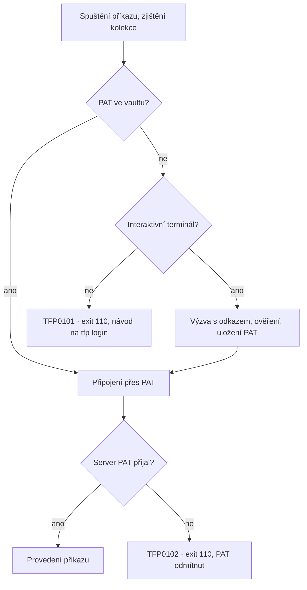

# TfPortable – specifikace

Stav k 2026-10-07. Exportováno z pracovního dokumentu; od teď je zdrojem pravdy tento soubor.

## Název a repozitář

Návrh: nástroj **TfPortable**, repozitář na GitHubu **`tfportable`**, výsledný soubor **`tfp.exe`** (p jako portable). Název říká to podstatné: je to tf v přenosné podobě (jeden soubor, bez instalace VS), a nekoliduje s TensorFlow zkratkami (TFLite, TFX), které by zaplevelily vyhledávání. Prefix `tfp` zároveň odpovídá chybovým kódům `TFPxxxx`.

| Varianta | Repozitář | Proč ano | Proč ne |
| --- | --- | --- | --- |
| **TfPortable** (doporučeno) | `tfportable` | Jasně říká „přenosný tf“, snadno se hledá | Neříká nic o PAT ani AI |
| TfPat | `tfpat` | Krátké, zdůrazňuje přihlášení přes PAT | Zní jako jednoúčelová utilita |
| TfvcCli | `tfvc-cli` | Popisné, zřejmé z názvu | Generické, pravděpodobně už obsazené |
| AgentTf | `agent-tf` | Zdůrazňuje AI použití | Odrazuje lidské uživatele |

Soubor se záměrně nejmenuje `tf.exe`. Kompatibilita je v příkazech a přepínačích, ne v názvu souboru; TfPortable se v detailech chová jinak (přihlášení přes PAT, žádné GUI, limit u `history`, rozšíření), takže stejný název by podle pořadí v PATH zakrýval, která implementace běží, a pletl hlášení chyb. Nástroj nemá svůj název natvrdo: v nápovědě, hláškách a radách používá skutečný název spuštěného souboru, takže kdo chce drop-in náhradu, přejmenuje ho na `tf.exe`. Příkazy v této specifikaci se píšou jako `tfp <příkaz>`; dostupnost názvu na GitHubu je potřeba před založením ověřit.

## Cíl a rozsah

TfPortable nahrazuje originální tf.exe pro práci s TFVC v Azure DevOps Services a Azure DevOps Serveru (on-prem TFS 2017+). Přihlašuje se jen přes PAT uložený ve Windows Credential Manageru, takže odpadá interaktivní přihlašování, MFA a rozpadající se cache tokenů. Primárním uživatelem je Claude Code, sekundárně člověk v terminálu. Podporují se jen lokální workspace.

**Principy**

- Názvy příkazů, aliasy a přepínače jsou kompatibilní s tf.exe. Co tf.exe umí, se volá stejně; rozšíření jsou nové přepínače nebo nové příkazy, nikdy změna významu existujících.
- Nástroj nikdy nečeká na vstup, pokud ho nevolá člověk v interaktivním terminálu. Žádná okna, žádné dialogy.
- Každá chyba říká co se stalo, proč a co s tím, a nese původní kód TFS (např. TF14045), pokud existuje.
- Výstup je deterministický, bez stránkování a barev, v UTF-8; na požádání v JSON.

**Fáze 1 (MVP): čtení a lokální operace** – přihlášení a správa PAT, kontext workspace, `status`, `add`, `delete`, `rename`/`move`, `checkout`/`edit`, `undo`, `get`, `dir`, `localversions`, `info`, `view`, `diff`, `history`, `changeset`, `workspaces`, `workfold`, `resolve`, `reconcile`, `labels`, `branches`.

**Fáze 2: větvení jako pending changes** – `merge` (jen pending), `branch` (jen pending), `rollback` (jen pending), `undelete`, `merges`, `folderdiff` a rozšíření `annotate`. Vyhledávání v obsahu historie (`history /comment`, `/changetype`, `/workitem`) bylo hotové už ve fázi 1. Zápisové příkazy fáze 2 vytvářejí jen pending changes ve workspace (úroveň 2), takže je lze vzít zpět přes `undo`; `merges`, `folderdiff` a `annotate` jen čtou (úroveň 1). Rozsah přepínačů: `merge /recursive`, `/version:<od>~<do>`, `/preview`, `/force`, `/baseless`, `/discard`, `/noimplicitbaseless`, `/conservative`, `/noautoresolve`, `/lock:none`, `/format:`; `branch /version:`, `/noget`, `/silent`, `/lock:none` (`/checkin`, `/comment`, `/author`, `/notes` se odmítají, zapisují rovnou changeset); `undelete /noget`, `/recursive`, `/lock:none`, itemspec s `;X<deletionId>`; `rollback /changeset:<c>[~<c>]` nebo `/toversion:<verze>` (právě jeden z nich, `/toversion` vyžaduje itemspec), `/recursive`, `/version:`, `/keepmergehistory`, `/noautoresolve`, `/lock:none`. `merge /preview` nemá v klientské knihovně protějšek: tfp vypíše změny kandidátních changesetů ve tvaru, v jakém by je merge vytvořil (viz `docs/compat.md` §15). `folderdiff` porovnává soubory podle obsahu (MD5 hash položky na serveru, lokální soubory se spočítají), s jednou cestou porovná složku s jejím protějškem ve workspace. `annotate` vypíše pro každý řádek souboru changeset, autora a datum, kdy řádek naposledy vznikl (vlastní řádkový diff přes historii souboru včetně přejmenování).

**Fáze 3: zápis na server pro běžnou práci** – `checkin` (klasický checkin pending changes), `label`/`unlabel` (označkování checkinu), `shelve` spolu se `shelvesets` a `unshelve` (uložení rozdělané práce na server a návrat k ní), `lock`/`unlock` (týmy s výhradním checkoutem). Součástí fáze 3 jsou úrovně ochrany (viz níže). Rozsah přepínačů: `checkin /comment` (povinný), `/associate:<work item>`, `/recursive`, `/noprompt`, `/validate` (zkušební průchod bez zápisu), `/override:<důvod>` (úroveň 2: důvod se zapíše do changesetu jako přebití policy, stejně jako ve Visual Studiu); `shelve /comment`, `/move`, `/replace`, `/recursive`, `/delete` (jen úroveň 3); `label /comment`, `/child:replace|merge`, `/recursive`, `/version`, `/delete` (jen úroveň 3); `lock /lock:checkin|checkout|none`, `/recursive` (checkout zámek lokální workspace nepodporuje, server vrací TF400022, exit 1). `checkin /force` zapíše i editaci s nezměněným obsahem. Rozšíření pro agenty: `checkin /format:json` vrací číslo changesetu a zapsané položky; konflikty a selhání policy jsou položkové chyby (`errors[]`), `checkin /validate` je vrátí s exit 100 bez zápisu.

**Checkin policies**: TFVC vyhodnocuje policy na klientovi a implementace žije ve Visual Studiu, takže tfp je vyhodnocuje sám: policy „Work Items“ (povinná vazba na work item) splní `/associate:<id>`, policy „Changeset Comments“ splní `/comment` (je povinný vždy). Každá jiná policy (Builds, Code Analysis, vlastní) je pro tfp neznámá: `TFP0409` s vysvětlením, že běží jen ve Visual Studiu. Nesplněná vyhodnocená policy je `TFP0407`. Obojí lze obejít přepínačem `/override:<důvod>` na úrovni 2; důvod se zapíše k changesetu jako ve Visual Studiu, které policy zobrazuje jako varování a po zadání důvodu checkin pustí.

**Fáze 4 (hypotetická): zbytek tf.exe** – všechny zbývající příkazy a přepínače včetně těch, které mění server nevratně (`destroy`, `permission`, `workspace /new` a `/delete`, `proxy`, `configure`). Zda je má nástroj umožnit, zatím není rozhodnuto; smysl by to mělo jen jako úplná náhrada tf.exe.

Příkazy pozdějších fází nástroj rozpozná a vrátí jasnou chybu `TFP0003 NotSupported` s číslem fáze a doporučením použít Visual Studio nebo originální tf.exe. Důvod: zapisují na server okamžitě a nevratně, kdežto pending changes ve fázi 1 jdou kdykoli vzít zpět přes `undo`.

## Architektura a build

Konzolová aplikace v C# pro .NET Framework 4.8 nad oficiálním TFVC klientským API od Microsoftu, sestavená do jednoho souboru `tfp.exe` pomocí Costura.Fody.

**Závislosti**

| Balíček | Verze | Účel |
| --- | --- | --- |
| [Microsoft.TeamFoundationServer.ExtendedClient](https://www.nuget.org/packages/Microsoft.TeamFoundationServer.ExtendedClient) | 20.256.2 (stabilní, net472) | `VersionControlServer`, `Workspace`, `Workstation`, pending changes, historie |
| Costura.Fody + Fody | 6.2.0 + 6.9.3 | Vložení všech spravovaných DLL do exe |
| Newtonsoft.Json | 13.0.3 (tranzitivně z ExtendedClient) | Výstup `/format:json`; žádná další závislost |
| xunit 2.9.3, Microsoft.NET.Test.Sdk 17.14.1 | – | Unit, integrační a golden testy (`tests/`) |
| Žádná další knihovna pro CLI | – | Parser přepínačů ve stylu tf.exe (`/switch:value`, `-switch:value`) je vlastní, protože běžné knihovny tuto syntaxi neumí |

Credential Manager se volá přes P/Invoke na `advapi32.dll` (`CredReadW`, `CredWriteW`, `CredDeleteW`, `CredEnumerateW` pro výčet uložených PAT), bez další závislosti.

**Struktura řešení**

```
tfportable/
  src/TfPortable/
    Program.cs                 vstup, globální zachytávání výjimek, exit kódy
    Cli/                       tokenizer a parser přepínačů, VersionSpec, ItemSpec
    Auth/                      CredentialStore (P/Invoke), PatPrompt, ConnectionFactory
    Context/                   detekce workspace a kolekce
    Commands/                  jedna třída na příkaz (StatusCommand, HistoryCommand…)
    Output/                    textový a JSON writer, formátování jako tf.exe
    Errors/                    TfpException, katalog chyb, mapování výjimek TFS
    FodyWeavers.xml
  tests/TfPortable.Tests/       unit testy parseru a mapování chyb
  tests/TfPortable.IntegrationTests/  testy proti testovací organizaci Azure DevOps
  docs/                        CLAUDE.md šablona, popis příkazů
```

**Jeden přenosný soubor**

- Costura vloží všechny spravované DLL jako komprimované prostředky a načítá je z paměti přes `AssemblyResolve`.
- Cíl je, aby nebyl potřeba ani `tfp.exe.config`. Binding redirecty řeší Costura; pokud by se ukázalo, že konfigurace je nutná, soubor se vloží do exe a aplikuje programově.
- ExtendedClient tahá i balíčky, které TFVC nepotřebuje (např. Microsoft.Data.SqlClient s nativní knihovnou SNI, nativní části pro work item tracking). Ty se vyřadí přes `ExcludeAssemblies` ve `FodyWeavers.xml` nebo přes `ExcludeAssets` v csproj, aby exe nebylo zbytečně velké a nevyžadovalo nativní DLL vedle sebe.
- Prvním úkolem implementace je spike: holé `tfp status` přes Costuru na čistém stroji bez VS. Pokud by embedding narazil (reflexní načítání pluginů klienta podle cesty), záložní varianta je ILRepack nebo ZIP s exe a DLL v jedné složce.
- Build: SDK-style csproj, `<TargetFramework>net48</TargetFramework>`, `<AssemblyName>tfp</AssemblyName>`, `<PlatformTarget>AnyCPU</PlatformTarget>` s `Prefer32Bit=false`. Verze assembly z git tagu: CI předá `/p:Version=<tag bez v>` (jinak `0.1.0-ci.<run>`), lokální build má `0.1.0-dev`; informační verze nese i hash commitu. Řešení je `TfPortable.slnx` (formát .NET SDK 9.0.200+), společná nastavení v `Directory.Build.props`.

## Autentizace (PAT)

Jediný způsob přihlášení je PAT uložený ve Windows Credential Manageru, jeden na kolekci (organizaci) a uživatelský profil. PAT nikdy neprojde přes AI: zadává ho člověk ve vlastním terminálu a nástroj ho nikdy nevypisuje.

**Uložení**

- Typ `CRED_TYPE_GENERIC`, persistence `CRED_PERSIST_LOCAL_MACHINE` (přežije odhlášení, váže se na uživatele a stroj, neroamuje).
- Target name: `TfPortable:<normalizovaná URL kolekce>`, např. `TfPortable:https://dev.azure.com/contoso`. Normalizace: malá písmena, bez lomítka na konci, `contoso.visualstudio.com` se převede na `dev.azure.com/contoso` a případný segment `/DefaultCollection` u Services se odstraní (klient i `tf workspaces` zobrazují kolekci jako `contoso.visualstudio.com\DefaultCollection`, viz golden `workspaces/detailed`). U Serveru zůstává celá URL kolekce včetně názvu kolekce.
- `UserName` = e-mail identity zjištěný při ověření, `Comment` = datum uložení. PAT je v `CredentialBlob`.
- Položka je vidět a smazatelná i ručně ve Správci přihlašovacích údajů Windows.

**Tok při každém příkazu**

1. Z kontextu (viz Detekce workspace) se zjistí URL kolekce.
2. Nástroj přečte PAT z Credential Manageru a připojí se přes `VssBasicCredential(string.Empty, pat)`.
3. PAT chybí a terminál je interaktivní (`!Console.IsInputRedirected`): nástroj vypíše, kde PAT vytvořit, vyžádá si ho se skrytým vstupem, ověří ho a uloží. Pak pokračuje původním příkazem.
4. PAT chybí a terminál není interaktivní (typicky Claude Code): okamžitě skončí chybou `TFP0101 PatMissing` s přesným příkazem (`tfp login /collection:<url>`), který má uživatel spustit ve svém terminálu. Nikdy nečeká na vstup.
5. Server PAT odmítne (HTTP 401, TF30063, TF400813): chyba `TFP0102 PatRejected` s původním kódem TF, vysvětlením (vypršel, byl zrušen, chybí scope) a návodem na `tfp login`. Uložený PAT se automaticky nemaže.



Bez interaktivního terminálu nástroj nikdy nečeká na vstup; obě chybové větve končí exit kódem 110.

**Příkazy pro správu**

| Příkaz | Co dělá |
| --- | --- |
| `tfp login [/collection:<url>]` | Vyžádá PAT (skrytý vstup), ověří ho a uloží; přepíše existující. Bez interaktivního terminálu skončí chybou. |
| `tfp login /collection:<url> /pat:-` | Přečte PAT ze stdin (pro skripty, PAT se neobjeví v historii příkazů). |
| `tfp logout [/collection:<url>]` | Smaže uložený PAT pro kolekci. |
| `tfp whoami [/collection:<url>]` | Ověří spojení a vypíše identitu, URL kolekce a datum uložení PAT. Ideální první krok pro AI. |

Kvůli kompatibilitě se přijímá i `/login:<user>,<pat>` z tf.exe; použije se jen pro daný běh, neukládá se a nástroj vypíše varování, že PAT zůstane v historii příkazů.

**Text výzvy při chybějícím PAT** (interaktivní i v chybě TFP0101)

```
No Personal Access Token (PAT) is stored for collection https://dev.azure.com/contoso.

Create one here:
  https://dev.azure.com/contoso/_usersSettings/tokens

If the link does not open the token page, use the web UI menu:
  Azure DevOps Services (dev.azure.com, *.visualstudio.com):
    user settings icon (top right) > Personal access tokens
  Azure DevOps Server / TFS 2017+ (your own domain, e.g. https://tfs.contoso.local/tfs):
    profile picture (top right) > Security > Personal access tokens

Token settings:
  1. New Token, Expiration: as needed (Services allow max. 1 year)
  2. Scopes: Full access
     (the TFVC API does not accept tokens with custom scopes, not even Code: Read & write)
  3. Create, then copy the token. It will not be shown again.

Paste the PAT (input is hidden):
```

Odkaz se vždy skládá ze skutečné URL kolekce: u Services `https://dev.azure.com/<org>/_usersSettings/tokens`, u Serveru `<URL kolekce>/_usersSettings/tokens`. Protože se umístění stránky mezi verzemi Serveru může lišit, výzva vždy uvádí i cestu v menu pro obě varianty. Klientské knihovny i PAT fungují stejně pro Services i Server; TFS 2015 a starší PAT nepodporují a nástroj je nepodporuje.

**Ověření PAT při uložení**: nejdřív REST `GET <kolekce>/_apis/connectionData` s Basic autentizací (nezávislé na SOAP klientovi; vrátí identitu). Odmítne-li server token (203 se sign-in stránkou nebo 401), PAT se neuloží. Jinak se PAT uloží a teprve pak se ověří TFVC (SOAP) spojení `TfsTeamProjectCollection.EnsureAuthenticated()` + zkušební dotaz na `$/`; jeho selhání je varování, ne chyba.

**Scope PAT (zjištěno ve spiku 2026-10-07)**: TFVC klient komunikuje přes legacy SOAP endpointy (`/Services/v3.0/LocationService.asmx`, `/VersionControl/v5.0/...`), které v Azure DevOps Services přijímají jen PAT se všemi scopy (Full access). PAT s vlastním výběrem scopů (i Code: Read & write) projde přes REST, ale SOAP odpoví 401 a klientská knihovna ohlásí TF30063; token poslaný jako Bearer odmítne také. Potvrzuje to i README rozšíření Azure Repos pro VS Code („TFVC repositories require tokens with All Scopes“). Důsledky: výzva k PAT žádá Full access; `TFP0103` hlásí tuto situaci (REST token přijal, SOAP ne) s návodem; `tfp whoami`/`status` po TF30063 ověří token přes REST a rozliší neplatný token (TFP0102) od chybějícího scope (TFP0103). Omezení na čtení (Code: Read) tedy přes PAT dosáhnout nelze.

## Detekce workspace a kolekce

Nástroj musí fungovat v každém adresáři namapovaném do workspace, i když workspace vytvořilo Visual Studio nebo originální tf.exe. Kolekce a workspace se určí v tomto pořadí; první úspěšný krok vyhrává.

1. Explicitní přepínače `/collection:<url>` a `/workspace:<name>[;<owner>]`.
2. Lokální cache workspace: `Workstation.Current.GetLocalWorkspaceInfo(cesta)` od aktuálního adresáře nahoru ke kořeni disku.
3. Proměnná prostředí `TFP_COLLECTION`, jinak jediný uložený PAT (pokud je ve vaultu právě jeden; zjistí se přes `CredEnumerateW` s filtrem `TfPortable:*`). Pak dotaz na server `QueryWorkspaces(null, AuthorizedUser, Environment.MachineName)`, výběr workspace, jehož mapování obsahuje aktuální cestu, a `Workstation.Current.UpdateWorkspaceInfoCache(...)`, aby příště stačil krok 2.
4. Nic z toho: chyba `TFP0201 WorkspaceNotFound`, která vypíše prohledané cesty, nalezené workspace na tomto stroji (pokud se podařilo připojit) a návod, jak kolekci zadat.

**Poznámky**

- Cache klientských knihoven je ve složce podle verze klienta (`%LOCALAPPDATA%\Microsoft\Team Foundation\<verze>\Cache`). Workspace vytvořené jinou verzí VS v ní nemusí být, proto krok 3.
- Podporují se jen lokální workspace (metadata ve složce `$tf`, stejně jako u VS). Zjistí-li nástroj serverový workspace (`WorkspaceLocation.Server`), skončí chybou `TFP0204 ServerWorkspaceNotSupported` s doporučením převést workspace na lokální ve VS (Manage Workspaces > Advanced > Location: Local).
- Příkazy pracující jen se serverovými cestami (`$/...`), např. `history`, `view`, `changeset`, `dir`, workspace nepotřebují, stačí kolekce.
- `tfp whoami` a `tfp workfold` vypíšou zjištěný kontext, takže AI si může ověřit, kde je, dřív než něco změní.
- Kontext se mezi běhy nekešuje jinak než přes standardní cache klienta. Žádné vlastní konfigurační soubory v adresáři projektu.

## Společné konvence CLI

Syntaxe je převzatá z tf.exe beze změny; odchylky jsou jen tam, kde by kompatibilní chování blokovalo neinteraktivní použití, a jsou vyjmenované na konci sekce.

**Syntaxe**

- `tfp [vc] <příkaz> [itemspec ...] [/přepínač[:hodnota]]`. Přepínače začínají `/` nebo `-`, nezáleží na velikosti písmen, hodnota za `:`, více hodnot oddělených čárkou.
- Prefix `vc` je volitelný a tiše se přeskočí: `tfp vc changeset 16878` = `tfp changeset 16878`. Jiné skupiny příkazů originálu (např. `tf git permission`) skončí chybou `TFP0003 NotSupported`.
- Aliasy příkazů jako v tf.exe, např. `checkout` = `edit`, `rename` = `move`, `difference` = `diff`, `properties` = `info`, `delete` = `del`.\*
- Zkratky přepínačů podle dokumentace tf.exe: `-R` /recursive, `-I` /noprompt, `-V` /version (i `/v:`), `-F` /format, `-U` /user, `-W` /workspace, `-S` /server, `-O` /owner, `-P` /force, `-N` /newname, `-K` /lock, `-Y` /login, `-M` /computer, `-X` /slotmode, `-?` a `-H` /help.
- Soubor s argumenty `@soubor.txt` (jeden argument na řádek), protože Claude Code občas potřebuje předat stovky cest.
- Neznámý příkaz: exit kód 2. Neznámý nebo neplatný přepínač: exit kód 100, stejně jako originál (golden výstup general/unknown-switch). V obou případech výpis platných příkazů nebo přepínačů, žádné tiché ignorování.
- Nápověda, hlášky a rady používají skutečný název spuštěného souboru (`tfp`, nebo `tf` po přejmenování).

\* Přesný seznam aliasů a přepínačů je převzatý z nápovědy originálního tf.exe 18.10, zachycené v `tests/golden/help/` (skript `tools/capture-tf-help.ps1`; `tf help <příkaz>` ve VS 18 vypíše jen banner, proto je zachyceno `tf vc help <příkaz>` a `tf <příkaz> /?`), a sepsaný po příkazech v `docs/commands.md` včetně toho, co TfPortable s každým přepínačem dělá. Tabulky níže uvádějí jen hlavní přepínače; při rozporu platí `docs/commands.md`.

**Itemspec**

- Lokální cesta (absolutní, relativní k aktuálnímu adresáři, nebo UNC) nebo serverová cesta `$/Projekt/...`.
- Lokální cesty přijímají oddělovače `\` i `/` a normalizují se, protože z Bashe chodí cesty jako `D:/Projects/App/BaseController.cs`. Serverové cesty používají vždy `/`.
- Zástupné znaky `*` a `?` v poslední části cesty, `/recursive` (zkratka `-R`) pro podstrom.
- Verze připojená k cestě: `$/Projekt/a.cs;C1234` nebo `a.cs;1234`.

**Versionspec**

| Zápis | Význam | Příklad |
| --- | --- | --- |
| `[C]<n>` | changeset; `C` lze vynechat | `C1234`, `1234` |
| `D<datum>` | stav k datu; nejprve ISO 8601, pak `DateTime.Parse` v aktuální kultuře (jako originál), pak invariantní kultura (`mm/dd/yyyy`); datum bez času znamená 00:00 místního času | `D2026-09-30`, `D2026-09-30T14:00` |
| `L<label>[@scope]` | label | `LRelease-2.1@$/Projekt` |
| `T` | nejnovější verze (tip) | `T` |
| `W[<workspace>[;<owner>]]` | verze ve workspace | `W` |
| `<od>~<do>` | rozsah (history, diff, merges) | `C1200~C1300`, `D2026-09-01~T` |

**Globální přepínače**

| Přepínač | Účinek |
| --- | --- |
| `/collection:<url>` (alias `/server`) | Kolekce, přebije detekci |
| `/workspace:<name>[;<owner>]` | Workspace, přebije detekci |
| `/login:<user>,<pat>` | PAT jen pro tento běh (kompatibilita) |
| `/noprompt` | Přijímá se; nástroj se ale chová neinteraktivně vždy, když není interaktivní terminál |
| `/format:json` | Strojově čitelný výstup (rozšíření, viz Rozšíření pro AI) |
| `/verbose` | Diagnostika na stderr: URL, volání API, časy, verze klientských knihoven |

**Výstup a kódování**

- `Console.OutputEncoding = UTF-8` bez BOM, aby české názvy souborů a komentáře checkinů prošly do Claude Code beze ztráty.
- Data na stdout, chyby a varování na stderr. Žádné barvy, žádné stránkování, žádný ukazatel průběhu.
- Textový formát kopíruje tf.exe (sloupce, hlavičky), aby fungovaly zažité postupy. Datum vždy ve formátu ISO 8601 v místním čase s offsetem (`2026-10-07T19:07:27+02:00`), aby ho AI četla jednoznačně.
- Cesty ve výstupu jsou vždy absolutní (lokální i serverové), nikdy zkrácené tečkami. Platí i pro skupinové výpisy (`add`, `checkout`, `delete`, `rename`, `undo`, `get`), kde originál píše hlavičky složek relativně k aktuálnímu adresáři.
- Šířka tabulek se počítá z dat (originál se vejde do 79 sloupců); poslední sloupec (komentář) se nikdy nezkracuje. Originál ho ořezává (`history/short-version`: `Fix null ch`).
- Co a kam se tiskne, kopíruje originál (`docs/compat.md` §1.2): chyby u položek a konflikty na stderr; hlášky o prázdném výsledku („There are no pending changes.“, „No items match $/…“, „No history entries…“) na stdout, i když je exit kód 1.

**Tvar textového výstupu** (podrobně po příkazech v `docs/compat.md`)

- Skupinový výpis: hlavička složky `<absolutní cesta>:`, pod ní položky, prázdný řádek mezi skupinami. Je-li složka rovna aktuálnímu adresáři, originál hlavičku vynechá; TfPortable ji vypíše vždy (cesty jsou absolutní).
- Tabulky `status`, `history`, `labels`, `workspaces`, `merges`: hlavička, řádek pomlček, řádky; u `status` seskupení pod serverovou složkou a trailer `Changes: N` / `Changes: 0, detected changes: N`; u `dir` a `localversions` trailer `Items: N`.
- Bloky `changeset` a `history /format:detailed`: `Changeset: N`, `User:`, `Date:`, prázdný řádek, `Comment:` + text odsazený dvěma mezerami, prázdný řádek, `Items:` + `<typy změn> <serverová cesta>` zarovnané na nejširší typ; sekce `Work items:` jen když existují. V historii oddělovač z pomlček před každým blokem.
- Typy změn anglicky malými písmeny, kombinace čárkou: `merge, edit`; `rename, edit, rollback`; `delete, source rename`.
- Smazané položky nesou `;X<deletionId>`, verze `;C<n>`.

**Exit kódy**

| Kód | Význam | Shodné s tf.exe |
| --- | --- | --- |
| 0 | Úspěch nebo prázdný výsledek (včetně `history` neznámé cesty a `difference` s rozdílnými soubory) | ano |
| 1 | Částečný úspěch, chyba u položky (`add`/`delete`/`view`/`dir`/`undelete` nenalezeno, `undo` bez změn), zbývající konflikty (`get`, `resolve`, `merge`), `workspaces` bez shody | ano |
| 2 | Neznámý příkaz | ano |
| 100 | Nic neproběhlo: neplatný přepínač nebo hodnota, `rename`/`changeset`/`label` nenalezeno, neznámá identita, shelveset nenalezen, chyba serveru | ano |
| 110 | Problém s přihlášením (PAT chybí nebo byl odmítnut) | rozšíření (originál 100) |
| 120 | Workspace nebo kolekce nenalezena, cesta nenamapovaná, serverový workspace | rozšíření (originál 100) |

Exit kód konkrétní situace kopíruje originál podle příkazu; úplná tabulka zjištěná z golden výstupů je v `docs/compat.md` §1.1 a golden testy ji vynucují. Originál není konzistentní („nenalezeno“ je 1, 100 nebo 0 podle příkazu), ale skripty i zvyklosti na jeho kódech závisí. Jediné záměrné odchylky jsou 110 a 120: AI z nich pozná, že řešením je `tfp login` nebo `/collection`, ne opakování příkazu.

**Odchylky od tf.exe**

- Příkazy, které v tf.exe otevírají GUI (`view`, `diff`, `resolve`, `workspace`, `history` bez `/noprompt`), zde vždy pracují v konzoli: `view` vypíše obsah na stdout (nebo do `/output:<soubor>`), `diff` vypíše unified diff.
- `history` bez `/stopafter` vrátí nejvýš 256 položek a na konci uvede, že výpis je zkrácený a jak získat další. Chrání to kontext AI před desítkami tisíc řádků.
- Kde by tf.exe položil otázku (např. přepsat zapisovatelné soubory při `get`), nástroj skončí chybou se seznamem dotčených souborů a přepínačem, který akci povolí.
- Výstup je vždy UTF-8; `view` dekóduje obsah podle kódování položky na serveru (`utf-8`, `windows-1250`, …) a překóduje ho. Originál zapsal UTF-8 soubor bez BOM syrově a v konzoli s jinou kódovou stránkou vznikl paskvil (golden `view/czech-name`); TfPortable tuto chybu nereprodukuje.
- Datum v ISO 8601 (originál: krátké a dlouhé datum v kultuře uživatele), poslední sloupec tabulek bez zkracování, absolutní cesty ve skupinových výpisech (viz Výstup a kódování).
- `tfp`, `tfp help` a `tfp help <příkaz>` vypíšou katalog příkazů, resp. přepínače příkazu; originál ve VS 18 vypíše jen banner s odkazem na `tf vc help`.
- `properties` nevypisuje varování o zastaralosti (originál ho píše na stderr, u aliasu `info` ne).
- `difference /format:context` není podporováno (TFP0002); AI ho nepotřebuje. `history /format:xml` odmítá i originál.
- Serverový workspace: originál s ním pracuje, TfPortable vrátí TFP0204 (viz Detekce workspace). `tfp workspaces` serverové workspace vypíše (sloupec umístění).
- `history` bez přepínače je ve slot módu (jako originál: u přejmenovaného souboru ukáže jen přejmenování, `/itemmode` sleduje položku napříč přejmenováním).
- `add` s explicitně zadaným souborem ho přidá, i když odpovídá `.tfignore` (jako originál); `.tfignore` se uplatní jen při expanzi zástupných znaků a `/recursive`.

## Katalog příkazů

Fáze 1 pokrývá 21 příkazů tf.exe a 3 příkazy pro správu PAT: vše pro práci v pracovním adresáři a čtení historie, bez zápisu checkinů. Každý příkaz přijímá i globální přepínače a `/format:json`. Seznam přepínačů se při implementaci porovná s `tf help <příkaz>` originálu a rozdíly se zapíšou do `docs/compat.md`.

**Práce v pracovním adresáři**

| Příkaz (aliasy) | Přepínače | Chování | Fáze |
| --- | --- | --- | --- |
| `status` (`stat`) | `/recursive` `/format:brief\|detailed` `/user:` `/workspace:` `/shelveset:` `/nodetect` | Pending changes; v lokálním workspace i detekované změny (candidates) zvlášť označené. `/format:xml` originálu (i u `workspaces` a `shelvesets`) se nepodporuje, místo něj `/format:json` | 1 |
| `add` | `/recursive` `/lock:none` `/encoding:` `/noignore` | Respektuje `.tfignore` při `/recursive` a zástupných znacích (vyloučené položky tiše vynechá, exit 0; originál při seedování hlásil exit 1, viz compat.md); explicitně zadaný soubor přidá vždy, `/noignore` přidá i vyloučené. `/lock:checkin\|checkout` odmítne (zámky zapisují na server) | 1 |
| `checkout` (`edit`) | `/recursive` `/lock:none` `/encoding:` | Označí soubor v lokálním workspace jako pending edit | 1 |
| `delete` (`del`) | `/recursive` `/lock:` `/detect` | Pending delete; soubor smaže lokálně jako tf.exe | 1 |
| `rename` (`move`, `ren`) | `/lock:` | Přejmenování i přesun souboru nebo složky | 1 |
| `undo` | `/recursive` `/workspace:` | Vrátí pending changes; vypíše, co vrátil | 1 |
| `get` | `/version:` `/recursive` `/all` `/overwrite` `/force` `/preview` `/remap` `/noautoresolve` | Při konfliktu se zapisovatelnými soubory skončí chybou se seznamem, ne otázkou | 1 |
| `resolve` | `/auto:AutoMerge\|AutoMergeForced\|TakeTheirs\|KeepYours\|OverwriteLocal\|DeleteConflict\|KeepYoursRenameTheirs` (aliasy z dokumentace `AcceptMerge`, `AcceptYours`, `AcceptTheirs`, `AcceptYoursRenameTheirs` se přijímají) `/preview` `/recursive` `/newname:` | Bez `/auto` jen vypíše konflikty (žádný dialog); dokud konflikty trvají, exit 1 a seznam na stderr jako originál; bez konfliktů exit 0 | 1 |
| `reconcile` | `/promote` `/adds` `/deletes` `/diff` `/clean` `/preview` `/recursive` `/noignore` | `/clean` maže soubory mimo správu verzí; bez `/preview` vyžaduje i `/noprompt`, aby AI nesmazala soubory omylem | 1 |
| `localversions` (`lv`) | `/recursive` `/format:` `/workspace:` | Verze souborů ve workspace | 1 |
| `workfold` | `/workspace:` (jen výpis) | Mapování aktuálního workspace | 1 |
| `workfold /map /unmap /cloak /decloak` | dle tf.exe | Mění mapování na serveru, vratné | 2 |
| `workspaces` | `/owner:` `/computer:` `/format:` `/collection:` | Seznam workspace včetně serverových (umístění ve výpisu); bez shody exit 1 a hláška na stdout jako originál; `/remove:` jen pro lokální cache | 1 |

**Historie, verze a obsah**

| Příkaz (aliasy) | Přepínače | Chování | Fáze |
| --- | --- | --- | --- |
| `history` (`hist`) | `/version:` `/stopafter:` `/recursive` `/user:` `/format:brief\|detailed` `/sort:` `/slotmode` `/itemmode` + rozšíření (viz Rozšíření pro AI) | Výchozí limit 256 položek; výchozí slot mód; u jednoho souboru má tabulka navíc sloupec Change; neznámá cesta = prázdný výsledek, exit 0; neznámý `/user:` exit 100 (TF14045); `/format:xml` odmítnuto | 1 |
| `changeset` | `<číslo>` `/latest` | Detail checkinu: autor, datum, komentář, změněné položky s typem změny, přidružené work items. `/comment:` (úprava komentáře) vrací TFP0003; neexistující číslo exit 100 (TF14019) | 1 |
| `view` | `/version:` `/output:<soubor>` `/shelveset:` `/recursive` `/console` (přijato, bez účinku) | Obsah souboru v dané verzi na stdout, překódovaný do UTF-8 podle kódování položky; binární soubory jen do `/output` (jinak TFP0303); nenalezeno exit 1. S `/format:json` je obsah textového souboru řetězec v `data.content`, binární soubor i tady vyžaduje `/output` | 1 |
| `difference` (`diff`) | `/version:` `/recursive` `/format:unified\|brief` `/ignorespace` `/ignoreeol` `/ignorecase` `/shelveset:` | Vždy textový unified diff; porovnání workspace × server, dvou verzí, dvou serverových cest, nebo shelvesetu; exit 0 i když se soubory liší (jako originál); binární soubory jen „files differ“ | 1 |
| `dir` | `/version:` `/recursive` `/folders` `/deleted` | Výpis serverové struktury | 1 |
| `properties` (`info`) | `/version:` `/recursive` `/workspace:` | Lokální i serverová verze, kódování, zámky, pending change | 1 |
| `labels` | `/owner:` `/format:` | Seznam labelů | 1 |
| `branches` | `/version:` | Strom větví pro položku | 1 |
| `merge /candidate` | `/recursive` `/version:` | Jen výpis changesetů, které ještě nejsou sloučené (čtecí operace); hvězdička za číslem označuje částečně sloučený changeset jako v originálu | 1 |
| `merges` | `/recursive` `/showall` `/format:brief\|detailed` | Historie sloučení mezi větvemi: tabulka Changeset, Merged in Changeset, Author, Date, hvězdička za částečným sloučením; `/format:detailed` vypíše cílové changesety jako `history /format:detailed` (`/extended` tf.exe 18.10 odmítá, nepodporuje se) | 2 |
| `annotate` | `/version:` | Kdo a ve kterém changesetu změnil každý řádek (rozšíření; tf.exe příkaz nezná, golden `annotate/attempt` exit 2); sloupce Changeset, Owner, Date, Line; složka TFP0002, binární soubor TFP0303, neexistující TFP0301 (exit 1) | 2 |
| `folderdiff` | `/recursive` `/filter:` `/view:same,different,sourceOnly,targetOnly` | Rozdíl dvou složek (server nebo lokální) nebo jedné složky a jejího protějšku ve workspace, podle obsahu (hash); sekce jako originál a řádek `Summary:`; jen text, bez dialogu | 2 |
| `shelvesets` | `/owner:` `/format:` | Seznam shelvesetů | 3 |
| `unshelve` | `<shelveset>[;<owner>]` `/recursive` | Jen bez `/move` (nemaže shelveset na serveru) | 3 |
| `merge` | `/recursive` `/version:` `/preview` `/force` `/baseless` `/discard` `/noimplicitbaseless` `/conservative` `/noautoresolve` `/lock:none` `/format:` | Pending merge ze zdroje do cíle; řádky `merge, <změna>: <zdroj>;C<n> -> <cíl>`; konflikt je položková chyba TFP0403 (exit 1) a pending merge zůstává jako v originálu; `/preview` aproximace z kandidátů | 2 |
| `branch` | `/version:` `/noget` `/silent` `/lock:none` | Pending branch; vypíše cílovou cestu a strom ve skupinách jako `add`; `/checkin` a spol. TFP0002 | 2 |
| `undelete` | `/noget` `/recursive` `/lock:none` | Pending undelete; `itemspec;X<deletionId>`; neexistující položka exit 1 jako originál | 2 |
| `rollback` | `/changeset:<c>[~<c>]` nebo `/toversion:<verze>` `/recursive` `/version:` `/keepmergehistory` `/noautoresolve` `/lock:none` | Pending rollback; `/changeset` bez itemspec vrátí celý changeset; bez změn `There is nothing to roll back.`; konflikty TFP0403 (exit 1) | 2 |

**Správa nástroje** (rozšíření): `login`, `logout`, `whoami` (viz Autentizace), `help [<příkaz>]`, `version`, `protection [set <1|2|3>]` (viz Úrovně ochrany).

## Úrovně ochrany

Nástroj pracuje v jedné ze tří úrovní ochrany. Každý příkaz a každý přepínač má v katalogu úroveň, kterou vyžaduje; příkaz vyžadující vyšší úroveň, než je nastavená, skončí chybou `TFP0004 ProtectionLevel` (exit 100) s nápovědou, jak úroveň změnit. Úroveň je zábrana a jasná smlouva, ne bezpečnostní hranice: skutečné vynucení na straně agenta zůstává v jeho oprávněních (např. `.claude/settings.json`).

| Úroveň | Co dovolí | Příkazy |
| --- | --- | --- |
| L1 | jen čtení (jediný zápis na disk je `view /output`) | `status`, `history`, `changeset`, `view`, `difference`, `dir`, `properties`, `localversions`, `workfold`, `workspaces`, `labels`, `branches`, `merge /candidate`, `shelvesets`, `annotate`, `merges`, `folderdiff`, `help`, `version`, `whoami`, `login`, `logout`, `protection` (zobrazení) |
| L2 (výchozí) | běžná práce: pending changes, aktualizace workspace a běžný zápis na server | L1 + `add`, `checkout`, `delete`, `rename`, `undo`, `get`, `resolve`, `reconcile`, `undelete`, `merge`, `branch`, `rollback`, `unshelve`, `checkin`, `shelve`, `label`, `unlabel`, `lock` |
| L3 | vše, včetně nevratných a cizích změn | L2 + `shelve /delete`, `label /delete`, `undo /workspace:<jméno>` (přepínač zvyšuje úroveň vždy, nástroj nerozlišuje vlastní a cizí workspace před připojením), `destroy`, `permission`, `workspace /new` a `/delete`, `proxy`, `configure`, `property` |

**Uložení**: `%APPDATA%\TfPortable\settings.json` (klíč `protectionLevel`, hodnoty 1–3). Chybí-li soubor, platí L2. CI, které potřebuje jinou úroveň, soubor nastaví v kroku pipeline; proměnná prostředí se nepoužívá.

**Změna**: jen příkaz `tfp protection set <1|2|3>` v interaktivním terminálu (stdin je terminál, stejná detekce jako u výzvy na PAT). Zvýšení úrovně vyžaduje napsat potvrzení, snížení ne. Bez terminálu příkaz skončí `TFP0004` s vysvětlením, že změna se dělá z interaktivního terminálu. Žádný přepínač příkazu úroveň neovlivní. `tfp protection` bez argumentu a `tfp whoami` úroveň zobrazí (JSON: `protectionLevel`).

**Hláška** (bez středníků, bez odkazu na osobu): `Command 'checkin' needs protection level 2. The current level is 1. Raise it with 'tfp protection set 2' in an interactive terminal.` Stejný text je v JSON v `hint`.

## Rozšíření pro AI

Rozšíření jsou jen nové přepínače a nové příkazy; žádný existující přepínač tf.exe nemění význam. Cílem je, aby Claude Code dostal přesně to, co potřebuje, jedním voláním a bez parsování tabulek.

**JSON výstup (`/format:json`)**

Každý příkaz vrátí na stdout právě jeden JSON dokument se stejnou obálkou, i při chybě:

```json
{
  "ok": false,
  "command": "get",
  "exitCode": 1,
  "collection": "https://dev.azure.com/contoso",
  "workspace": "DEV-PC;jan.novak@contoso.com",
  "data": { "updated": 12, "added": 3, "deleted": 0 },
  "truncated": null,
  "warnings": [],
  "errors": [
    {
      "code": "TFP0402",
      "tfCode": "TF10141",
      "message": "File C:\\Src\\App\\Config.xml is writable and has no pending change; get did not overwrite it.",
      "hint": "Review local changes with 'tfp diff'. Use 'tfp get /overwrite' to overwrite it.",
      "item": "C:\\Src\\App\\Config.xml"
    }
  ]
}
```

Názvy polí v `data` jsou anglické, v camelCase, stabilní mezi verzemi a popsané v `docs/json-schema.md` (návrh obálky, sdílených typů a `data` pro každý příkaz fáze 1). Data jsou ISO 8601 s offsetem, čísla changesetů jako čísla. `truncated` je `null`, nebo objekt `{ returned, limit, hint }`. `warnings` a `errors` mají stejný tvar zprávy (`code`, `tfCode`, `message`, `hint`, `item`, `activityId`). V JSON režimu je stderr prázdný (kromě `/verbose`).

**Vyhledávání v historii**

| Přepínač u `history` | Význam | Fáze |
| --- | --- | --- |
| `/comment:<text>` | Changesety, jejichž komentář obsahuje text (bez ohledu na velikost písmen) | 1 |
| `/comment:/<regex>/` | Totéž regulárním výrazem (.NET syntaxe) | 1 |
| `/changetype:add,edit,delete,rename,merge,branch` | Jen changesety s daným typem změny na hledaných položkách | 1 |
| `/workitem:<id>` | Changesety propojené s work itemem | 1 |
| `/files` | V brief výpisu uvede i změněné soubory (bez nutnosti `/format:detailed`) | 1 |
| `/contains:<text>` | Changesety, jejichž diff obsahuje text; drahé, vždy omezené `/stopafter` | 2 |

Filtrování probíhá na klientu nad výsledkem `QueryHistory`, takže `/stopafter` se vztahuje k počtu nalezených, ne prohledaných changesetů. Prohledávání se zastaví po 5 000 changesetech a výsledek uvede, kam až došlo, aby šlo navázat přes `/version:`.

**Další rozšíření**

- `changeset <číslo> /diff` vypíše unified diff celého changesetu (všechny soubory proti předchozí verzi). Hlavní nástroj pro kontrolu checkinů.
- `whoami` vrátí identitu, kolekci, workspace a mapování v jednom volání.
- `help /format:json` vrátí strojově čitelný katalog příkazů a přepínačů, aby si AI mohla ověřit syntaxi bez zkoušení.
- `version` vypíše verzi TfPortable a klientských knihoven (do hlášení chyb).

## Chybové hlášky

Každá chyba nese stabilní kód nástroje (`TFPxxxx`), původní kód TFS (`TFxxxxx`), pokud existuje, a původní zprávu serveru beze změny, aby se dala dohledat na internetu. K tomu jednou větou co dělat dál.

**Textový formát (stderr)**

```
ERROR TFP0301 [TF14019]: Item $/Contoso/App/Old.cs does not exist at version C1200.
  Server message: TF14019: The item $/Contoso/App/Old.cs could not be found at version C1200.
  Next step: Check the path with 'tfp dir $/Contoso/App /version:C1200' or find a rename with 'tfp history ... /changetype:rename'.
  ActivityId: 6f0e2c1a-...
```

**Pravidla**

- Klientské knihovny běží s `CurrentUICulture = en-US`, takže původní zprávy TFS jsou vždy anglicky a dohledatelné. Vlastní zprávy a rady nástroje jsou také anglicky, aby byl nástroj univerzální.
- Kód TF se z výjimky vytáhne regulárním výrazem `\bTF\d{5,6}\b`; chybí-li, pole `tfCode` je `null`.
- U chyb ze serveru se přidá `ActivityId` z odpovědi, aby šla chyba spárovat s logy serveru.
- Chyba u jedné položky nezastaví zpracování ostatních: výsledkem je exit kód 1 a seznam chyb po položkách.
- Neočekávaná výjimka: `TFP0900` s typem výjimky a zprávou; celý stack trace se zapíše do `%TEMP%\TfPortable\last-error.txt` a cesta k souboru je v hlášce. S `/verbose` jde stack trace rovnou na stderr.
- PAT se nikdy neobjeví v žádné hlášce, logu ani výstupu `/verbose`.
- Varování mají na stderr tvar `WARNING TFPxxxx: <text>` (kód jen pokud existuje), v JSON jsou v poli `warnings`.

**Katalog**

Sloupec Exit je výchozí hodnota; u situací, kde originál vrací podle příkazu jiný kód, platí
tabulka v `docs/compat.md` §1.1 (např. TFP0301 je 1 u `add`, `delete`, `view`, `dir`,
`undelete`, 100 u `rename`, `changeset`, `label`, 0 u `history`).

| Kód | Situace | Typické TF kódy / výjimka | Rada uživateli | Exit |
| --- | --- | --- | --- | --- |
| TFP0001 | Neznámý příkaz | – | Seznam příkazů, `tfp help` | 2 |
| TFP0002 | Neplatný přepínač nebo hodnota | – | Platné přepínače příkazu | 100 |
| TFP0003 | Příkaz mimo rozsah nástroje | – | Použít VS nebo originální tf.exe | 100 |
| TFP0004 | Příkaz nebo přepínač nad nastavenou úrovní ochrany | – | `tfp protection set <n>` v interaktivním terminálu | 100 |
| TFP0101 | Chybí PAT | – | Spustit `tfp login /collection:<url>` ve vlastním terminálu | 110 |
| TFP0102 | PAT odmítnut | TF30063, TF400813, HTTP 401 | Vypršel nebo byl zrušen; vytvořit nový, `tfp login` | 110 |
| TFP0103 | PAT bez potřebného scope (REST token přijal, TFVC SOAP API ne) | TF30063 po úspěšném REST ověření, HTTP 403 | Vytvořit PAT se Scopes: Full access, `tfp login` | 110 |
| TFP0104 | Nelze číst nebo zapsat Credential Manager | Win32 chyba | Kód Win32 chyby, kontrola profilu | 110 |
| TFP0201 | Workspace nenalezen | – | Prohledané cesty, nalezené workspace, `/collection` | 120 |
| TFP0202 | Server nedostupný | DNS, proxy, timeout | URL, proxy z prostředí, `/verbose` | 100 |
| TFP0203 | Cesta není namapovaná | – | Mapování workspace (`tfp workfold`) | 120 |
| TFP0204 | Serverový workspace | – | Převést workspace na lokální ve VS | 120 |
| TFP0301 | Položka nebo verze neexistuje | např. TF14019 | `tfp dir` / `tfp history` pro dohledání | 100 |
| TFP0302 | Neplatná versionspec | – | Podporované formáty s příkladem | 100 |
| TFP0303 | Binární obsah nelze vypsat na konzoli | – | `tfp view … /output:<soubor>` | 100 |
| TFP0401 | Položka už má jinou pending change | – | Stav přes `tfp status`, případně `tfp undo` | 1 |
| TFP0402 | Get nepřepsal zapisovatelný soubor | – | `tfp diff`, pak `tfp get /overwrite` | 1 |
| TFP0403 | Get vytvořil konflikty | – | Seznam konfliktů, `tfp resolve /auto:...` | 1 |
| TFP0404 | Položka je zamčená jiným uživatelem | – | Kdo zámek drží a od kdy | 1 |
| TFP0405 | `reconcile /clean` bez potvrzení | – | Spustit s `/preview`, pak s `/noprompt` | 100 |
| TFP0406 | Checkin zastavily konflikty (novější verze na serveru, zámek) | TF10141 | `tfp get`, `tfp resolve`, u zámku jeho vlastník | 100 |
| TFP0407 | Checkin zastavily nesplněné checkin policies (vyhodnocené tfp) nebo povinné poznámky, nebo je checkin gated | – | Opravit, nebo `/override:<důvod>` | 100 |
| TFP0408 | Shelveset stejného jména už existuje | – | Jiné jméno, nebo `/replace` | 100 |
| TFP0409 | Checkin policy, kterou tfp neumí vyhodnotit (běží jen ve Visual Studiu) | – | Ověřit ve Visual Studiu, nebo `/override:<důvod>` | 100 |
| TFP0501 | Chyba serveru | HTTP 5xx | ActivityId, zkusit znovu | 100 |
| TFP0900 | Neočekávaná chyba | jakákoli | Cesta k `last-error.txt`, `tfp version` | 100 |

Exit kódy v tabulce jsou výchozí hodnoty. Kde golden výstupy originálu ukazují jiný kód pro stejnou situaci, platí golden výstup; rozdíly jsou zapsané v `docs/compat.md` §1.1.

Konkrétní TF kódy v tabulce a příkladech jsou ilustrační. Skutečné mapování se sestaví během implementace z reálných odpovědí serveru a uloží jako testovací data.

## Integrace s Claude Code

Claude Code na Windows spouští příkazy přes Git Bash, a to má jednu zásadní past: MSYS převádí argumenty začínající `/` na cesty, takže z `/recursive` se stane `C:/Program Files/Git/recursive`. Proto Claude Code používá přepínače s pomlčkou (`-recursive`), které tf.exe i TfPortable přijímají.

**Instalace**

1. `tfp.exe` do vlastní složky, např. `C:\Tools\TfPortable\`.
2. Složku přidat do uživatelské proměnné PATH (s originálním tf.exe nekoliduje, protože má jiný název), nebo ji v CLAUDE.md uvést plnou cestou.
3. Uživatel jednou ve svém terminálu spustí `tfp login /collection:https://dev.azure.com/<org>`.

**Ochrana proti převodu cest**: chybu `TFP0002` nástroj ohlásí jen u argumentu, který začíná kořenem instalace Git for Windows (zjištěným z prostředí Git Bashe, např. `MSYSTEM`, a z umístění `git.exe`) a pokračuje názvem známého přepínače, např. `C:/Program Files/Git/recursive`. Běžné lokální cesty s dopřednými lomítky (`D:/Projects/App/recursive`) se jako chyba nehlásí. Hláška vysvětlí příčinu a doporučí `-přepínač` nebo `MSYS_NO_PATHCONV=1`.

**Šablona do CLAUDE.md** (v repozitáři jako `docs/CLAUDE.md`; udržovanou verzí je ten soubor, zde je výchozí znění)

```markdown
## Správa verzí: TFVC přes TfPortable

- Repozitář je v TFVC, ne v Gitu. Používej `tfp` (TfPortable), nikdy git.
- Přepínače piš s pomlčkou: `tfp status -recursive`, ne `/recursive`.
- Serverové cesty dávej do jednoduchých uvozovek: `'$/Projekt/src'`.
- Pro strojové zpracování přidej `-format:json`.
- Na začátku práce spusť `tfp whoami -format:json`.
- Checkin nedělej; nástroj ho ani nepodporuje. Změny nech jako pending changes.
- Exit kód 110 znamená problém s PAT: řekni uživateli, ať spustí `tfp login` ve svém terminálu. Sám PAT nikdy nezadávej ani nežádej.
- Před `tfp get`, `tfp undo` a `tfp reconcile` napřed spusť variantu s `-preview`, pokud ji příkaz má.
```

**Oprávnění v `.claude/settings.json`**

Čtecí příkazy povolit bez ptaní, měnící nechat na potvrzení:

```json
{
  "permissions": {
    "allow": [
      "Bash(tfp status:*)", "Bash(tfp history:*)", "Bash(tfp changeset:*)",
      "Bash(tfp view:*)", "Bash(tfp diff:*)", "Bash(tfp dir:*)",
      "Bash(tfp info:*)", "Bash(tfp properties:*)", "Bash(tfp localversions:*)",
      "Bash(tfp workfold:*)", "Bash(tfp workspaces:*)", "Bash(tfp whoami:*)",
      "Bash(tfp labels:*)", "Bash(tfp branches:*)", "Bash(tfp help:*)"
    ],
    "ask": [
      "Bash(tfp get:*)", "Bash(tfp undo:*)", "Bash(tfp reconcile:*)",
      "Bash(tfp resolve:*)", "Bash(tfp delete:*)"
    ]
  }
}
```

`add`, `checkout` a `rename` jsou vratné přes `undo`, takže je lze podle zvyku týmu přesunout do `allow`.

## Testování, rizika a milníky

**Testování**

- Unit testy: parser přepínačů (`-` i `/`, zkratky `-R`/`-I`/`-V`, aliasy, prefix `vc`, `@soubor`, převedené MSYS cesty), versionspec (včetně čísla bez `C`) a itemspec (normalizace `/` a `\`), mapování výjimek na kódy TFP, JSON obálka.
- Kompatibilita: sada příkazů spuštěná originálním tf.exe i TfPortable nad stejným workspace; porovnává se exit kód a obsah výstupu (se známými odchylkami). Sada zahrnuje i příkazy ze současných instrukcí Claude Code: `vc changeset <n> -noprompt`, `vc view "D:/…" -version:C<n> -noprompt`, `vc workspaces -noprompt`, `status -recursive`, `diff`, `add`, `delete`, `rename`.
- Integrační testy proti testovací organizaci Azure DevOps se samostatným projektem TFVC; PAT z proměnné prostředí v CI, nikdy v repozitáři.
- Ruční test přenositelnosti: čistý Windows bez Visual Studia, jen `tfp.exe`, příkazy `login`, `whoami`, `status`, `history`.

**Rizika**

| Riziko | Dopad | Opatření |
| --- | --- | --- |
| Licence knihoven Microsoftu ([license terms](https://www.nuget.org/packages/Microsoft.TeamFoundationServer.ExtendedClient/20.256.2/License)) zakazuje podřídit jejich kód licenci, která vyžaduje zveřejnění zdrojů nebo právo na úpravy, a chce po koncových uživatelích souhlas s ochrannými podmínkami. GPL v3 vyžaduje opak. | Vydání `tfp.exe` s vloženými DLL pod čistou GPL v3 by porušovalo obě licence | Zvoleno: GPL v3 s dodatečným povolením (sekce 7) pro knihovny Microsoftu, THIRD-PARTY-NOTICES s licencí Microsoftu; před prvním vydáním ověřit s právníkem |
| Licence Microsoftu zakazuje použít jeho ochranné známky v názvu programu | Spor o název | README s prohlášením, že nejde o produkt Microsoftu; v názvu nepoužívat „Team Foundation“ ani „Azure DevOps“ |
| Costura nezvládne některé knihovny klienta (reflexní načítání, nativní DLL) | Nebude jeden exe | Spike jako první krok; záloha ILRepack nebo složka s DLL |
| Formát lokálního workspace (`$tf`) se liší mezi verzemi klienta | Kolize s VS na stejném workspace | Test souběžné práce VS a TfPortable na jednom workspace v milníku 1 |
| Organizace zakáže PAT politikou | Nástroj nepůjde použít | Ověřit nastavení organizace předem; jasná chyba TFP0102 |
| Microsoft přestane vydávat ExtendedClient pro .NET Framework | Bez aktualizací | Verze 20.x je aktuální (stabilní z 3/2026, preview z 9/2026); sledovat |
| Výstup se liší od tf.exe v detailech | Skripty a zvyklosti AI se rozbijí | Golden testy proti nasbíraným výstupům originálu, `docs/compat.md` |

**Rozhodnutí a otevřené otázky**

- Jazyk vlastních hlášek a rad: rozhodnuto, vše anglicky (výstup nástroje, výzvy i chyby).
- Cílové prostředí: rozhodnuto, Azure DevOps Services (primárně) i Azure DevOps Server / TFS 2017+ (stejný klientský kód, výzva k PAT popisuje obě varianty).
- Workspace: rozhodnuto, jen lokální. Serverový workspace vrátí TFP0204 ServerWorkspaceNotSupported.
- Licence: rozhodnuto, GNU GPL v3 s dodatečným povolením podle sekce 7 pro klientské knihovny Microsoftu. Repozitář obsahuje LICENSE (GPL v3), LICENSE-EXCEPTION (text povolení) a THIRD-PARTY-NOTICES (licence Microsoftu pro vložené knihovny).
- Exit kódy a streamy: rozhodnuto (2026-10-07, analýza golden výstupů), kopírují originál podle příkazu; jen 110 a 120 jsou rozšíření. Podrobnosti `docs/compat.md`.
- Tvar výstupu: rozhodnuto ISO 8601, UTF-8 s překódováním u `view`, žádné varování u `properties`, katalog v `help`, nezkracování posledního sloupce a absolutní cesty ve skupinových výpisech (Gate A, 2026-10-07).
- Výchozí výstup je text ve tvaru tf.exe; JSON jen na vyžádání přes `/format:json` (tf.exe JSON nemá). Schéma v `docs/json-schema.md` vychází z polí, která originál tiskne v golden výstupech.
- Otevřené: `add /recursive` s položkami přeskočenými kvůli `.tfignore` (exit 1 podle poznámky v seed skriptu, golden případ chybí); `reconcile /promote` v golden běhu nic nepovýšil, ověřit v integračním testu, zda jsou potřeba `/adds` a `/deletes`.

**Milníky**

1. Spike: Costura + `whoami` a `status` na čistém stroji, PAT ve vaultu. Brána: jeden exe funguje bez VS.
2. Jádro: parser, kontext workspace, chyby, JSON obálka, `login`/`logout`/`whoami`.
3. Lokální operace: `status`, `add`, `checkout`, `delete`, `rename`, `undo`, `get`, `resolve`, `reconcile`, `localversions`, `workfold`, `workspaces`.
4. Historie a obsah: `history` včetně vyhledávání, `changeset /diff`, `view`, `diff`, `dir`, `properties`, `labels`, `branches`, `merge /candidate`.
5. Integrace: šablona CLAUDE.md, kompatibilní testy, release `tfp.exe` na GitHubu.
6. Fáze 2 podle potřeby (zadána 2026-10-08 po fázi 3, viz `docs/PROGRESS.md`).

## Build a testovací prostředí

Kód se dá přeložit kdekoli, ale spustit a otestovat jen na Windows. Agent v cloudu proto píše kód na Linuxu a jedinou zpětnou vazbu ze skutečného běhu dostává z Windows CI.

| Prostředí | Co tam jde | Co tam nejde |
| --- | --- | --- |
| Lokální Windows (Claude Code u vývojáře) | build, všechny testy, ruční zkouška `tfp.exe`, spike | – |
| Claude Code v cloudu (Linux) | psaní kódu, `dotnet build` proti referenčním assembly, unit testy parseru jen pokud běží bez Windows API | spuštění `tfp.exe`, Costura, Credential Manager, integrační a golden testy |
| GitHub Actions `windows-latest` | build Release, unit, golden a integrační testy, artefakt `tfp.exe` | `tfp login` (interaktivní) |

**Pravidla**

- csproj je SDK-style s `<TargetFramework>net48</TargetFramework>` a balíčkem `Microsoft.NETFramework.ReferenceAssemblies` (`PrivateAssets="all"`), aby `dotnet build` prošel i na Linuxu.
- Integrační a golden testy čtou `TFP_TEST_COLLECTION` a `TFP_TEST_PAT` z prostředí. Když chybí (Linux, pull request z forku), testy se přeskočí a neselžou. V CI je dodávají GitHub Secrets.
- Golden testy pouštějí `tfp` proti testovacímu projektu a porovnávají s výstupy v `tests/golden`: vždy exit kód, (ne)prázdnost stdout a stderr, seznam položek, čísla changesetů a pořadí, typy změn a součty v trailerech. Texty hlášek se neporovnávají, protože golden výstupy jsou z české instalace a `tfp` píše anglicky. Čísla changesetů se mapují přes manifesty v `tests/golden/manifests/`. Formát souborů, placeholdery, normalizace a seznam přehratelných případů jsou v `docs/golden-format.md`; známé odchylky v `docs/compat.md`.
- Agent v cloudu pracuje ve větvi, otevře pull request a výsledek CI čte přes `gh run view --log-failed`. Když CI třikrát po sobě selže na stejném problému, zastaví se a popíše ho v `docs/PROGRESS.md`.
- Spike (milník 1) se dělá lokálně, protože rozhoduje o architektuře a potřebuje rychlou smyčku na Windows.

## Podklady pro implementaci

Specifikace stačí agentovi na fázi 1, pokud dostane tři věci navíc: rozhodnutou licenci, vzorky výstupu originálního tf.exe a přístup k testovací kolekci. Bez vzorků by textový výstup „jako tf.exe“ musel hádat, bez testovací kolekce ověří jen unit testy.

**Co připravit před zadáním**

- [x] Přidat LICENSE, LICENSE-EXCEPTION a THIRD-PARTY-NOTICES (licence je rozhodnutá).
- [x] Nasbírat výstupy originálu: pro každý příkaz fáze 1 úspěšný případ, prázdný výsledek a typické chyby, se stdout, stderr a exit kódem, do `tests/golden/<příkaz>/<případ>.txt`. Skript capture-tf-golden.ps1 jména, e-maily a URL anonymizuje sám; výstup přesto zkontrolovat. (Hotovo 2026-10-07, 203 případů, zkontrolováno v KICKOFF-LOCAL kroku 0.)
- [ ] Zachytit nápovědu originálu (`tools/capture-tf-help.ps1` → `tests/golden/help/`), aby implementátor měl seznam přepínačů a aliasů.
- [x] Založit testovací projekt TFVC v Azure DevOps Services a naplnit ho skriptem seed-tfvc-test-repo.ps1 (changesety, přejmenování, smazání, label, větev, merge, různá kódování). PAT nejde omezit na projekt, jen na organizaci a scope; proto PAT vystavit pro samostatného uživatele, který má přístup jen k testovacímu projektu (nebo pro samostatnou testovací organizaci), a uložit ho do GitHub Secrets. (Projekt existuje; GitHub Secrets ještě ne, viz PROGRESS.md „Needs the user“.)

**Požadavky na implementaci**

- Přístup k API Microsoftu jen přes vlastní rozhraní (např. `ITfvcClient`), aby šly příkazy testovat bez serveru.
- C# s `LangVersion` latest, jen funkce, které nepotřebují novější runtime než .NET Framework 4.8; nullable reference types zapnuté.
- CI: GitHub Actions na `windows-latest`, build Release, unit testy, artefakt `tfp.exe`; při tagu `v*` release s `tfp.exe` a SHA-256.
- Definice hotovo pro každý příkaz: parser s unit testy, shoda s golden výstupem (nebo zapsaná odchylka v `docs/compat.md`), JSON výstup popsaný v `docs/json-schema.md`, chyby jen z katalogu, `tfp help <příkaz>`.
- Kde specifikace mlčí, platí chování originálu podle [dokumentace TFVC příkazů](https://learn.microsoft.com/en-us/azure/devops/repos/tfvc/use-team-foundation-version-control-commands?view=azure-devops) a golden výstupů.

**Postup**: milník 1 (spike) dělá lokální Claude Code na Windows a zastaví se s reportem (funguje Costura, velikost `tfp.exe`). Lokální Claude Code pak projde golden výstupy, sepíše `docs/compat.md` a zpřesní tuto specifikaci. Milníky 2–5 dělá Claude Code v cloudu s Windows CI jako zpětnou vazbou. Fáze 2 jen na samostatné zadání. Stav práce se vede v `docs/PROGRESS.md` (viz Předávka).

## Předávka

Práce pokračuje v repozitáři `tfportable` bez této konverzace. Všechno, co agenti potřebují, je v těchto souborech:

| Soubor | Účel |
| --- | --- |
| `docs/SPEC.md` | Tato specifikace exportovaná do Markdownu; jediný zdroj pravdy o chování |
| `CLAUDE.md` | Pravidla pro každého agenta v repozitáři: co číst, jak pracovat, jak hlásit postup |
| `docs/PROGRESS.md` | Stav milníků, rozhodnutí, otevřené otázky a log sezení; agent ho aktualizuje na konci každého sezení |
| `docs/KICKOFF-LOCAL.md` | Zadání pro první sezení lokálního Claude Code (zpřesnění specifikace a spike) |
| `docs/compat.md` | Rozdíly proti originálu zjištěné z golden výstupů (vytvoří lokální agent) |
| `tests/golden/`, `tools/` | Golden výstupy originálu a skripty, které je vytvořily |
